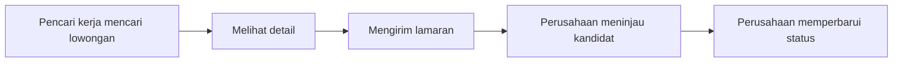

<div align="center">

# 🚀 AreaKerja Web

### Temukan peluang. Bangun koneksi. Kembangkan karier.

Platform karier berbasis web yang mempertemukan **pencari kerja** dengan **perusahaan**—mulai dari pencarian lowongan hingga pengelolaan kandidat.


</div>

---

## Tentang proyek

**AreaKerja Web** merupakan bagian dari ekosistem AreaKerja. Aplikasi ini menyediakan pengalaman pencarian kerja bagi kandidat dan alat pengelolaan rekrutmen bagi perusahaan. Backend Laravel juga menyediakan REST API yang ditujukan untuk integrasi dengan aplikasi mobile AreaKerja.

## Peran dan kemampuan

| Peran | Kemampuan utama |
|---|---|
| **Pencari kerja** | Mengelola profil, CV, pendidikan, pengalaman, dan keahlian; mencari lowongan; menyimpan dan melamar pekerjaan; memantau lamaran |
| **Perusahaan** | Mengelola profil dan lowongan, melihat kandidat, serta menangani proses lamaran |
| **Admin** | Mengelola pengguna, perusahaan, lowongan, kategori, konten, dan pengaturan platform |

## Alur lamaran



## Teknologi

- **Backend:** PHP 8.1+, Laravel 10, Eloquent ORM
- **Web:** Blade, Tailwind CSS, Flowbite, JavaScript, Vite
- **API:** REST API dengan Laravel Sanctum
- **Database:** MySQL
- **Integrasi yang tercantum di dependency:** Socialite, Xendit, Browsershot

## Persyaratan

- PHP 8.1 atau lebih baru
- Composer
- Node.js dan npm
- MySQL

## Menjalankan secara lokal

```bash
# Clone repository
 git clone https://github.com/ArdiannXyz/AreaKerja_web.git
cd AreaKerja_web

# Install dependency
composer install
npm install

# Buat konfigurasi lokal
cp .env.example .env
php artisan key:generate
```

Atur koneksi database dan konfigurasi layanan yang digunakan di `.env`, lalu siapkan skema dan aset:

```bash
php artisan migrate --seed
npm run build
php artisan serve
```

Untuk pengembangan frontend dengan hot reload, jalankan `npm run dev` di terminal terpisah. Aplikasi tersedia di [http://127.0.0.1:8000](http://127.0.0.1:8000).

> Seeder mungkin berisi data contoh, tetapi akun demo dan kredensialnya perlu diperiksa di source code proyek. Jangan gunakan data lokal atau credential development di production.

## Perintah pengembangan

```bash
php artisan test          # Jalankan test
php artisan route:list    # Lihat route yang tersedia
php artisan optimize:clear # Bersihkan cache Laravel
```

## Struktur ringkas

```text
app/                 Controllers, requests, models, services, repositories
resources/views/     Template Blade
resources/css/       Stylesheet
resources/js/        JavaScript
routes/              Route web dan API
database/            Migration, factory, seeder
tests/               Test aplikasi
```

## Integrasi mobile

Aplikasi mobile AreaKerja menggunakan backend ini melalui REST API. Base path API dan daftar endpoint yang tersedia mengikuti implementasi route di `routes/api.php`; periksa file tersebut untuk endpoint dan autentikasi yang benar sebelum mengintegrasikan client.

## Status proyek

README ini merangkum tujuan dan teknologi proyek. Untuk mengetahui fitur yang sudah aktif, gunakan implementasi route, controller, dan test sebagai acuan—daftar fitur atau roadmap tidak selalu berarti setiap fitur sudah tersedia.

---

<div align="center">

**AreaKerja — Connecting Talent with Opportunity.**

</div>
